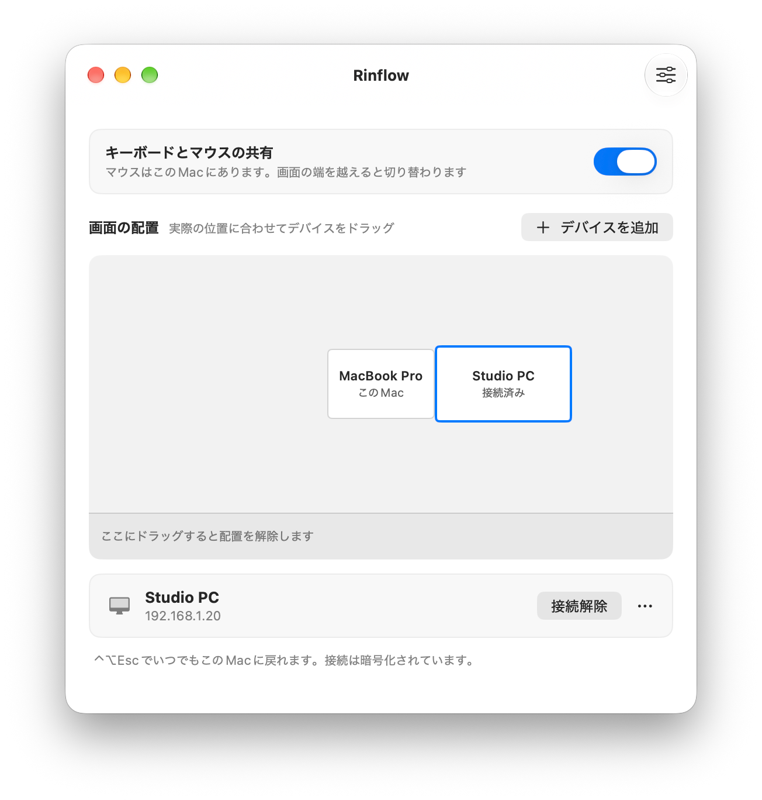

# Rinflow for macOS

[English](README.md) | [简体中文](README.zh-CN.md) | 日本語

Rinflow は、ローカルネットワーク上の複数のコンピューターで 1 組のキーボードとマウスを共有するソフトウェアです。ポインターを画面の端の外へ動かすと、隣のデバイスを操作できます。

これは macOS クライアントです。[Windows クライアント](https://github.com/rinflow-dev/rinflow-windows)と連携でき、[rinflow-core](https://github.com/rinflow-dev/rinflow-core) をベースにしています。

<p align="center">
  <picture>
    <source media="(prefers-color-scheme: dark)" srcset="docs/images/devices-ja-JP-dark.png">
    
  </picture>
</p>

**状態：** 開発初期の段階です。既知の問題は[変更履歴](CHANGELOG.md)をご覧ください。

## ダウンロード

お使いの Mac に合ったディスクイメージを [Releases](https://github.com/rinflow-dev/rinflow-macos/releases/latest) からダウンロードし、開いて Rinflow を「アプリケーション」へドラッグします。macOS 14 以降が必要で、署名と公証済みです。

| お使いの Mac | ファイル |
| --- | --- |
| Apple シリコン（M1 以降） | `Rinflow-<バージョン>-macOS-arm64.dmg` |
| Intel プロセッサ | `Rinflow-<バージョン>-macOS-x64.dmg` |

どちらか分からない場合は、アップルメニューの「このMacについて」を開きます。「チップ」に M1 以降と表示されていれば Apple シリコン、「プロセッサ」に Intel と表示されていれば Intel です。ターミナルで次のコマンドを実行すると、自動で判別して適切なファイルをダウンロードし、SHA-256 を確認してからインストールします。

```sh
curl -fsSL https://raw.githubusercontent.com/rinflow-dev/rinflow-macos/main/scripts/install.sh | sh
```

## 機能

- 画面の端を越えて他のデバイスを操作でき、他のデバイスから操作されることも可能
- デバイスをドラッグしてディスプレイの周囲に配置
- 暗号化接続と 6 桁のコードによるペアリング
- クリップボードとファイルの同期（任意、既定ではオフ）
- ログイン時の起動、デバイス切り替えのショートカット、現在の画面へのロック
- 日本語・英語・簡体字中国語のインターフェース

## ビルド

macOS 14 以降、Xcode 26 以降、[Rust](https://rustup.rs) が必要です。

```sh
git clone https://github.com/rinflow-dev/rinflow-core.git
git clone https://github.com/rinflow-dev/rinflow-macos.git
cd rinflow-macos
make run
```

`make test` でテストを実行します。Apple Development 証明書がない場合はアドホック署名になり、ビルドのたびにアクセシビリティの権限を付与し直す必要がある場合があります。

## 使い方

1. 同じネットワーク上の両方のデバイスで Rinflow を起動し、アクセシビリティの権限を付与します。
2. デバイスに接続し、両方に同じ 6 桁のコードが表示されていることを確認します。
3. デバイスを、実際に置かれている画面の側へドラッグします。
4. ポインターをその端の外へ押し出します。**⌃⌥Esc** で操作を戻せます。

アプリの画面は現在、英語と簡体字中国語に対応しています。

## ドキュメント（英語）

- [リリースチェックリスト](docs/release-checklist.md)：署名、公証、手動テスト
- [Core のドキュメント](https://github.com/rinflow-dev/rinflow-core#documentation)

## コントリビュート

[CONTRIBUTING.md](CONTRIBUTING.md) をご覧ください。脆弱性の報告については [SECURITY.md](SECURITY.md) をご覧ください。

## ライセンス

[Mozilla Public License 2.0](LICENSE)。サードパーティ製ソフトウェアは [THIRD_PARTY_NOTICES.txt](Rinflow/Resources/THIRD_PARTY_NOTICES.txt) に記載しています。
