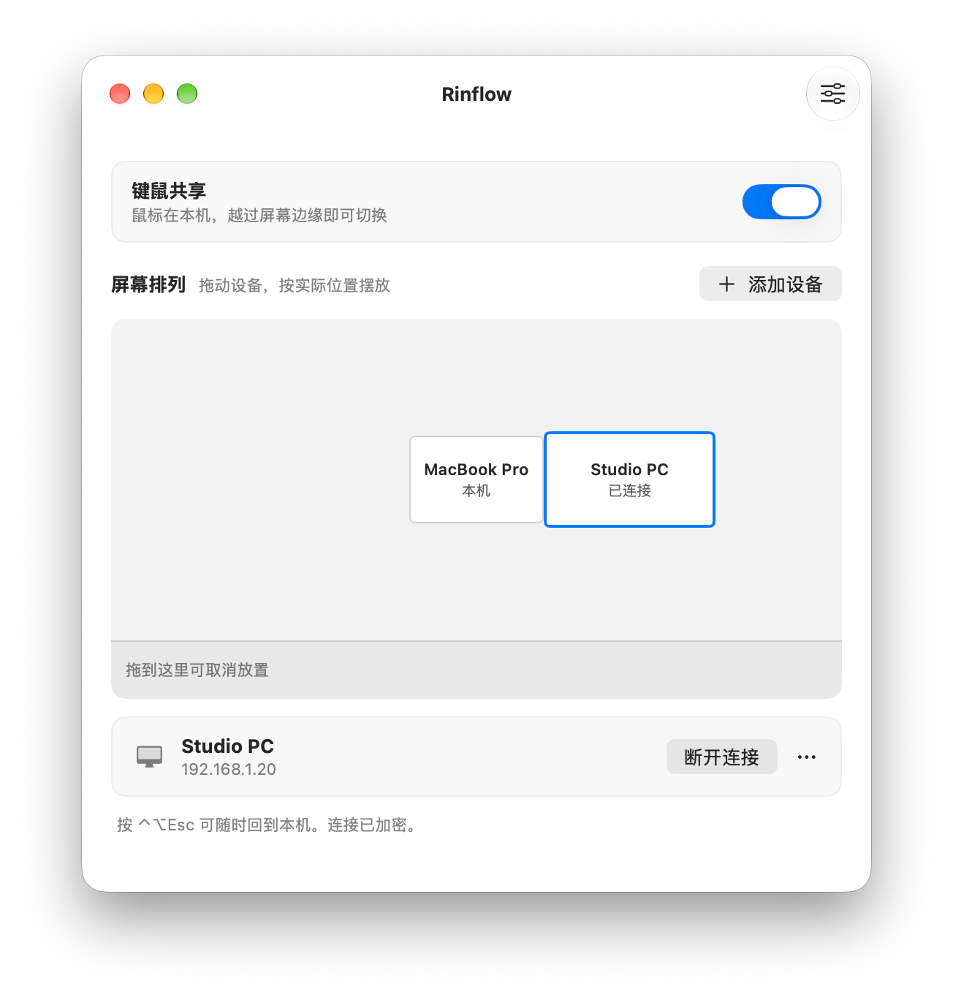

# Rinflow for macOS

[English](README.md) | 简体中文 | [日本語](README.ja.md)

Rinflow 让局域网内的多台电脑共用一套键盘和鼠标：把指针移过屏幕边缘，就能控制下一台设备。

这是 macOS 客户端，可与 [Windows 客户端](https://github.com/rinflow-dev/rinflow-windows)配合使用，基于 [rinflow-core](https://github.com/rinflow-dev/rinflow-core) 构建。

<p align="center">
  <picture>
    <source media="(prefers-color-scheme: dark)" srcset="docs/images/devices-zh-CN-dark.png">
    
  </picture>
</p>

**状态：** 早期开发阶段。已知问题见[变更日志](CHANGELOG.md)。

## 下载

从 [Releases](https://github.com/rinflow-dev/rinflow-macos/releases/latest) 下载适合你 Mac 的磁盘映像，打开后把 Rinflow 拖进“应用程序”。需要 macOS 14 或更高版本，已签名并公证。

| 你的 Mac | 文件 |
| --- | --- |
| Apple 芯片（M1 及之后） | `Rinflow-<版本>-macOS-arm64.dmg` |
| Intel 处理器 | `Rinflow-<版本>-macOS-x64.dmg` |

不确定选哪个？打开苹果菜单中的“关于本机”：“芯片”显示 M1 或更新型号就是 Apple 芯片，“处理器”显示 Intel 就是 Intel。也可以在“终端”中运行下面的命令，它会自动识别、下载对应的文件，核对 SHA-256 后安装：

```sh
curl -fsSL https://raw.githubusercontent.com/rinflow-dev/rinflow-macos/main/scripts/install.sh | sh
```

## 功能

- 越过屏幕边缘即可控制其他设备，也可被其他设备控制
- 拖动设备，排列到显示器周围
- 加密连接，六位配对码
- 可选的剪贴板和文件同步，默认关闭
- 登录时启动、切换设备的快捷键、锁定到当前屏幕
- 简体中文、英文、日文界面

## 构建

需要 macOS 14 或更高版本、Xcode 26 或更高版本，以及 [Rust](https://rustup.rs)。

```sh
git clone https://github.com/rinflow-dev/rinflow-core.git
git clone https://github.com/rinflow-dev/rinflow-macos.git
cd rinflow-macos
make run
```

`make test` 运行测试。没有 Apple Development 证书时会使用临时签名，每次构建后可能需要重新授予辅助功能权限。

## 使用

1. 在同一网络的两台设备上启动 Rinflow，并授予辅助功能权限。
2. 连接设备，确认两边显示相同的六位配对码。
3. 把设备拖到它实际所在的屏幕一侧。
4. 把指针推过该边缘。按 **⌃⌥Esc** 收回控制。

## 文档（英文）
- [发布清单](docs/release-checklist.md)：签名、公证和手动测试
- [Core 文档](https://github.com/rinflow-dev/rinflow-core#documentation)

## 参与贡献

见 [CONTRIBUTING.md](CONTRIBUTING.md)。报告安全漏洞见 [SECURITY.md](SECURITY.md)。

## 许可证

[Mozilla Public License 2.0](LICENSE)。第三方软件见 [THIRD_PARTY_NOTICES.txt](Rinflow/Resources/THIRD_PARTY_NOTICES.txt)。
